<div align="center">

<picture>
  <source media="(prefers-color-scheme: dark)" srcset="assets/hero-dark.svg">
  <source media="(prefers-color-scheme: light)" srcset="assets/hero-light.svg">
  
</picture>

<br>

<a href="thesis/MRI_of_a_Mad_Machine_Thesis.pdf"></a>
<a href="#08-every-number-is-checked"></a>
<a href="https://doi.org/10.17605/OSF.IO/CS967"></a>
<a href="#09-inside-this-package"></a>
<a href="https://rejaulkorimsadi.github.io/MRI-of-a-Mad-Machine/"></a>

<sub><b>B.Sc. thesis</b> · Department of Computer Science and Engineering · Metropolitan University, Sylhet · November 2026</sub>

<sub><a href="#01-the-claim">The claim</a> · <a href="#02-the-scan-result">Scan result</a> · <a href="#04-study-a--attention">Study A</a> · <a href="#05-study-b--commitment">Study B</a> · <a href="#06-study-c--the-surface">Study C</a> · <a href="#07-how-a-confident-error-is-assembled">Synthesis</a> · <a href="#08-every-number-is-checked">Verification</a> · <a href="#3d-model">3D model</a> · <a href="#10-reproduce-it">Reproduce</a></sub>

</div>

<br>

<a id="01-the-claim"></a>
<picture>
  <source media="(prefers-color-scheme: dark)" srcset="assets/d01-dark.svg">
  <source media="(prefers-color-scheme: light)" srcset="assets/d01-light.svg">
  
</picture>

Ask GPT-2 who created Python and it answers, without hesitation, **"the late Paul Graham."** The answer is Guido van Rossum. The sentence is fluent, specific and completely confident, and nothing in its wording says it is wrong.

The usual taxonomies sort errors like this by how the output relates to a source. They do not say **which part of the model** produced the error, so they cannot say where to intervene. This thesis treats the model the way a radiologist treats a patient in a scanner: **change one component at a time, hold everything else fixed, and watch which errors change.**

> [!IMPORTANT]
> **Central claim.** A confident hallucination is assembled by distinct parts of the model.
> **Context mixing** decides whether a false input becomes an error. **Decoding commitment** decides how far the error spreads. **The output surface** hides that the answer is a guess. Each role is measured from outputs alone, with interventions anyone can run.

<br>

<a id="02-the-scan-result"></a>
<picture>
  <source media="(prefers-color-scheme: dark)" srcset="assets/d02-dark.svg">
  <source media="(prefers-color-scheme: light)" srcset="assets/d02-light.svg">
  
</picture>

<picture>
  <source media="(prefers-color-scheme: dark)" srcset="assets/component_map-dark.svg">
  <source media="(prefers-color-scheme: light)" srcset="assets/component_map-light.svg">
  
</picture>

| Component | What it decides | Key evidence |
|---|---|---|
| **Context mixing** | Whether a defect in the input becomes an output error | 650 vs 566 of 666 at 2.8B · 264 vs 210 of 279 on facts both models knew |
| **Decoding commitment** | How far a first error spreads | 92.5% → 48.1% · a different wrong fact works as well · only 2 of 111 known |
| **Output surface** | Whether the user can see the guess | 75.3% of wrong answers unhedged · AUROC 0.56 |

<br>

<a id="03-how-the-scan-works"></a>
<picture>
  <source media="(prefers-color-scheme: dark)" srcset="assets/d03-dark.svg">
  <source media="(prefers-color-scheme: light)" srcset="assets/d03-light.svg">
  
</picture>

<picture>
  <source media="(prefers-color-scheme: dark)" srcset="assets/method-dark.svg">
  <source media="(prefers-color-scheme: light)" srcset="assets/method-light.svg">
  
</picture>

Every study follows the same four rules. Hypotheses were fixed before any output was scored. Human scoring was done twice, blind to which model wrote each answer (Cohen's κ from 0.85 to 1.00). Failed predictions are reported next to the ones that held. And every reported number is recomputed from the released raw files by one script.

<br>

<a id="04-study-a--attention"></a>
<picture>
  <source media="(prefers-color-scheme: dark)" srcset="assets/d04-dark.svg">
  <source media="(prefers-color-scheme: light)" srcset="assets/d04-light.svg">
  
</picture>

**Question.** When a passage in the input contradicts what a model knows, does the way the model mixes context decide which one wins?

**Design.** [Pythia](https://github.com/EleutherAI/pythia) (attention) and [Mamba](https://github.com/state-spaces/mamba) (selective state space) were trained on **the same data (the Pile) with the same tokenizer (GPT-NeoX)**. Five size-matched pairs from 130M to 2.8B parameters, plus four more attention models (Qwen2.5-0.5B, 1.5B, 3B and SmolLM2-1.7B): **14 models, all run on one 8 GB laptop GPU.** Two probes:

- **Free recall.** 200 SimpleQA questions, 2.8B pair, scored blind by two annotators (κ = 0.85).
- **Context conflict.** 111 facts, each asked alone, with a planted false line in a 9-line or 31-line text (early, middle or late), and with a planted true line. That is 999 items per model and 666 conflict items.

<picture>
  <source media="(prefers-color-scheme: dark)" srcset="assets/study_a-dark.svg">
  <source media="(prefers-color-scheme: light)" srcset="assets/study_a-light.svg">
  
</picture>

| What we measured | Attention · Pythia-2.8B | State space · Mamba-2.8B | Test |
|---|:---:|:---:|:---:|
| Free recall: SimpleQA answered correctly, of 200 | 3 | 3 | p = 1.000 |
| Planted false line repeated, of 666 | **650** | **566** | **90 vs 6 discordant · p = 2.5 × 10⁻²⁰** |
| Same test on facts **both models knew**, of 279 | **264** | **210** | **p = 9.0 × 10⁻¹³** |
| Planted true line read correctly, of 111 | 111 | 110 | reading control |

<details>
<summary><b>All five matched pairs</b> (conflict items followed, of 666)</summary>

| Pair (attention vs state space) | Pythia | Mamba | Discordant | Exact McNemar p |
|---|:---:|:---:|:---:|:---:|
| 160M vs 130M | 312 | 271 | 152 / 111 | 0.0135 |
| 410M vs 370M | 646 | 427 | 228 / 9 | 5.3 × 10⁻⁵⁶ |
| 1B vs 790M | 653 | 542 | 113 / 2 | 3.2 × 10⁻³¹ |
| 1.4B vs 1.4B | 648 | 186 | **462 / 0** | 1.7 × 10⁻¹³⁹ |
| 2.8B vs 2.8B | 650 | 566 | 90 / 6 | 2.5 × 10⁻²⁰ |

Group test on the 31-line texts: attention mean 91.1% vs state space 52.9% (Mann-Whitney p = 0.007). At 160M the pattern is mixed: on facts both models knew, the attention model followed the false line less often (8 vs 14 of 15).
</details>

**Reading.** Removing attention leaves recall from memory unchanged. It changes whether a passage can override what the model knows, **even when the model knew better.** Attention is the machinery of context grounding, and that machinery cuts both ways: it is what makes retrieval work when the text is true, and a direct route to confident error when it is false.

<br>

<a id="05-study-b--commitment"></a>
<picture>
  <source media="(prefers-color-scheme: dark)" srcset="assets/d05-dark.svg">
  <source media="(prefers-color-scheme: light)" srcset="assets/d05-light.svg">
  
</picture>

**Question.** Once a model writes its first wrong fact, are the later errors caused by that commitment, or by a truth the model knew and suppressed?

**Design.** 111 wrong answers from three instruction-tuned models (GPT-OSS-120B, Qwen3.6-27B, ALLaM-2-7B). In each answer, the **first wrong fact** was replaced and the model continued writing. Four conditions: as generated, correct fact inserted, a **different wrong fact** inserted, and the question asked in isolation. Two annotators scored blind (κ = 0.94 for downstream error, 1.00 for isolated correctness).

<picture>
  <source media="(prefers-color-scheme: dark)" srcset="assets/study_b-dark.svg">
  <source media="(prefers-color-scheme: light)" srcset="assets/study_b-light.svg">
  
</picture>

| Condition | Result |
|---|---|
| Answers with a later error, before → after the repair | **92.5% → 48.1%** (50 fixed, 3 broken, n = 106, p = 5.5 × 10⁻¹²) |
| Second annotator's independent scores | 97.2% → 50.0% (p = 2.35 × 10⁻¹⁴) |
| Correct fact inserted vs a **different wrong fact** | 54.6% vs 60.8% error-free (n = 97, p = 0.38) |
| Model answers correctly when asked on its own | **2 of 111** |

**Reading.** The later errors are **elaborations of the model's own committed claim.** Replace that claim with anything at all and about half of them disappear. The model was not hiding the truth: on these long-tail questions it never knew the answer. Repairing an answer at the point of divergence works even without supplying the truth.

<br>

<a id="06-study-c--the-surface"></a>
<picture>
  <source media="(prefers-color-scheme: dark)" srcset="assets/d06-dark.svg">
  <source media="(prefers-color-scheme: light)" srcset="assets/d06-light.svg">
  
</picture>

**Question.** When a question is missing information, do models ask, or guess? And if they guess, can the user tell?

**Design.** Registered on OSF **before any response was scored** ([10.17605/OSF.IO/CS967](https://doi.org/10.17605/OSF.IO/CS967)). Five open-weight models from four organisations (Gemma 3 27B, Gemma 4 31B, gpt-oss-120b, Qwen3-Next-80B-A3B, Nemotron 3 Super) at temperature 0. 142 factual questions, each in a fully specified form and with its key referent removed (same answer key), plus three identity probes. 5,620 responses scored blind by two raters (κ = 0.853 for correctness, 1.00 for verbal uncertainty).

<picture>
  <source media="(prefers-color-scheme: dark)" srcset="assets/study_c-dark.svg">
  <source media="(prefers-color-scheme: light)" srcset="assets/study_c-light.svg">
  
</picture>

| Finding | Number |
|---|---|
| Referent removed: models ask for clarification | 33.7% of prompts |
| Error among attempted answers, intact → referent removed | **39.1% → 52.0%** (mixed-effects OR 4.12, 95% CI 2.76–6.14) |
| Wrong answers that carry **no hedge** | **75.3%** |
| How well hedging separates right from wrong (0.5 = chance) | **AUROC 0.56** |
| Same 50 questions, the user claims an identity | mean answer length 188 words (anonymous) vs 259–268 (patient, physician, researcher) |

**Reading.** When information is missing, models usually guess, and the wording barely changes. Hedging is not a usable warning sign. Evaluations should score clarification as a good outcome rather than read confidence from tone.

<br>

<a id="07-how-a-confident-error-is-assembled"></a>
<picture>
  <source media="(prefers-color-scheme: dark)" srcset="assets/d07-dark.svg">
  <source media="(prefers-color-scheme: light)" srcset="assets/d07-light.svg">
  
</picture>

<picture>
  <source media="(prefers-color-scheme: dark)" srcset="assets/assembly-dark.svg">
  <source media="(prefers-color-scheme: light)" srcset="assets/assembly-light.svg">
  
</picture>

An error starts either in the input or in missing knowledge. If the input holds a false statement, **context mixing** decides whether it wins over what the model learned, and attention lets it win far more often than a state-space mixer does. If knowledge is missing, the model produces a first wrong claim anyway. Once that claim is written, **decoding commits** to it and elaborates it. Through all of this the **surface** stays the same, so the user receives a fluent, confident, false answer with no cue to doubt it.

**What follows for builders.**
- **Retrieval systems inherit attention's deference.** An attention model will tend to repeat what it retrieves, true or false, so provenance matters as much as the model.
- **Repair at the point of divergence.** Interrupting the first wrong claim during decoding is a targeted fix, and it works without knowing the truth.
- **Do not read confidence from wording.** Treat clarification as a correct outcome. Do not use unprompted hedging as an uncertainty signal.

<br>

<a id="08-every-number-is-checked"></a>
<picture>
  <source media="(prefers-color-scheme: dark)" srcset="assets/d08-dark.svg">
  <source media="(prefers-color-scheme: light)" srcset="assets/d08-light.svg">
  
</picture>

<picture>
  <source media="(prefers-color-scheme: dark)" srcset="assets/verify-dark.svg">
  <source media="(prefers-color-scheme: light)" srcset="assets/verify-light.svg">
  
</picture>

[`verification/verify_thesis_numbers.py`](verification/verify_thesis_numbers.py) reads the released raw files directly, recomputes each reported figure with its own code, and compares it with the thesis.

```text
132 checks, 132 passed, 0 failed
```

Studies A and B are recomputed in full. For Study C the script recomputes what the released scoring sheets support (the original-label figures: 39.9% → 66.7%, and 77.4% unhedged). The thesis reports those as a robustness check beside the final, audited registered analysis; the conclusion is the same under both. The full table is in [`verification/verification_report.txt`](verification/verification_report.txt) and Appendix A of the thesis.

<br>

<a id="3d-model"></a>

### The machine in 3D

The thesis's three-layer machine: training objective (red), context mixing (teal) and decoding (amber), with the output tokens rising from the top and the scanning collar around it.

<p align="center">
<picture>
  <source media="(prefers-color-scheme: dark)" srcset="assets/turntable-dark.gif">
  <source media="(prefers-color-scheme: light)" srcset="assets/turntable-light.gif">
  
</picture>
</p>

The same model as an interactive object: **drag to rotate, scroll to zoom.** A higher-resolution version is in [`assets/mri_machine_3d.stl`](assets/mri_machine_3d.stl).

```stl
solid mri_of_a_mad_machine
 facet normal 0.000 0.000 -1.000
  outer loop
   vertex -30.00 -30.00 0.00
   vertex 30.00 30.00 0.00
   vertex 30.00 -30.00 0.00
  endloop
 endfacet
 facet normal 0.000 0.000 -1.000
  outer loop
   vertex -30.00 -30.00 0.00
   vertex -30.00 30.00 0.00
   vertex 30.00 30.00 0.00
  endloop
 endfacet
 facet normal 0.000 0.000 1.000
  outer loop
   vertex -30.00 -30.00 8.00
   vertex 30.00 -30.00 8.00
   vertex 30.00 30.00 8.00
  endloop
 endfacet
 facet normal 0.000 0.000 1.000
  outer loop
   vertex -30.00 -30.00 8.00
   vertex 30.00 30.00 8.00
   vertex -30.00 30.00 8.00
  endloop
 endfacet
 facet normal 0.000 -1.000 0.000
  outer loop
   vertex -30.00 -30.00 0.00
   vertex 30.00 -30.00 0.00
   vertex 30.00 -30.00 8.00
  endloop
 endfacet
 facet normal 0.000 -1.000 0.000
  outer loop
   vertex -30.00 -30.00 0.00
   vertex 30.00 -30.00 8.00
   vertex -30.00 -30.00 8.00
  endloop
 endfacet
 facet normal 1.000 0.000 0.000
  outer loop
   vertex 30.00 -30.00 0.00
   vertex 30.00 30.00 0.00
   vertex 30.00 30.00 8.00
  endloop
 endfacet
 facet normal 1.000 0.000 0.000
  outer loop
   vertex 30.00 -30.00 0.00
   vertex 30.00 30.00 8.00
   vertex 30.00 -30.00 8.00
  endloop
 endfacet
 facet normal 0.000 1.000 0.000
  outer loop
   vertex 30.00 30.00 0.00
   vertex -30.00 30.00 0.00
   vertex -30.00 30.00 8.00
  endloop
 endfacet
 facet normal 0.000 1.000 -0.000
  outer loop
   vertex 30.00 30.00 0.00
   vertex -30.00 30.00 8.00
   vertex 30.00 30.00 8.00
  endloop
 endfacet
 facet normal -1.000 0.000 0.000
  outer loop
   vertex -30.00 30.00 0.00
   vertex -30.00 -30.00 0.00
   vertex -30.00 -30.00 8.00
  endloop
 endfacet
 facet normal -1.000 0.000 0.000
  outer loop
   vertex -30.00 30.00 0.00
   vertex -30.00 -30.00 8.00
   vertex -30.00 30.00 8.00
  endloop
 endfacet
 facet normal 0.000 0.000 -1.000
  outer loop
   vertex -30.00 -30.00 20.00
   vertex 30.00 30.00 20.00
   vertex 30.00 -30.00 20.00
  endloop
 endfacet
 facet normal 0.000 0.000 -1.000
  outer loop
   vertex -30.00 -30.00 20.00
   vertex -30.00 30.00 20.00
   vertex 30.00 30.00 20.00
  endloop
 endfacet
 facet normal 0.000 0.000 1.000
  outer loop
   vertex -30.00 -30.00 28.00
   vertex 30.00 -30.00 28.00
   vertex 30.00 30.00 28.00
  endloop
 endfacet
 facet normal 0.000 0.000 1.000
  outer loop
   vertex -30.00 -30.00 28.00
   vertex 30.00 30.00 28.00
   vertex -30.00 30.00 28.00
  endloop
 endfacet
 facet normal 0.000 -1.000 0.000
  outer loop
   vertex -30.00 -30.00 20.00
   vertex 30.00 -30.00 20.00
   vertex 30.00 -30.00 28.00
  endloop
 endfacet
 facet normal 0.000 -1.000 0.000
  outer loop
   vertex -30.00 -30.00 20.00
   vertex 30.00 -30.00 28.00
   vertex -30.00 -30.00 28.00
  endloop
 endfacet
 facet normal 1.000 0.000 0.000
  outer loop
   vertex 30.00 -30.00 20.00
   vertex 30.00 30.00 20.00
   vertex 30.00 30.00 28.00
  endloop
 endfacet
 facet normal 1.000 0.000 0.000
  outer loop
   vertex 30.00 -30.00 20.00
   vertex 30.00 30.00 28.00
   vertex 30.00 -30.00 28.00
  endloop
 endfacet
 facet normal 0.000 1.000 0.000
  outer loop
   vertex 30.00 30.00 20.00
   vertex -30.00 30.00 20.00
   vertex -30.00 30.00 28.00
  endloop
 endfacet
 facet normal 0.000 1.000 -0.000
  outer loop
   vertex 30.00 30.00 20.00
   vertex -30.00 30.00 28.00
   vertex 30.00 30.00 28.00
  endloop
 endfacet
 facet normal -1.000 0.000 0.000
  outer loop
   vertex -30.00 30.00 20.00
   vertex -30.00 -30.00 20.00
   vertex -30.00 -30.00 28.00
  endloop
 endfacet
 facet normal -1.000 0.000 0.000
  outer loop
   vertex -30.00 30.00 20.00
   vertex -30.00 -30.00 28.00
   vertex -30.00 30.00 28.00
  endloop
 endfacet
 facet normal 0.000 0.000 -1.000
  outer loop
   vertex -30.00 -30.00 40.00
   vertex 30.00 30.00 40.00
   vertex 30.00 -30.00 40.00
  endloop
 endfacet
 facet normal 0.000 0.000 -1.000
  outer loop
   vertex -30.00 -30.00 40.00
   vertex -30.00 30.00 40.00
   vertex 30.00 30.00 40.00
  endloop
 endfacet
 facet normal 0.000 0.000 1.000
  outer loop
   vertex -30.00 -30.00 48.00
   vertex 30.00 -30.00 48.00
   vertex 30.00 30.00 48.00
  endloop
 endfacet
 facet normal 0.000 0.000 1.000
  outer loop
   vertex -30.00 -30.00 48.00
   vertex 30.00 30.00 48.00
   vertex -30.00 30.00 48.00
  endloop
 endfacet
 facet normal 0.000 -1.000 0.000
  outer loop
   vertex -30.00 -30.00 40.00
   vertex 30.00 -30.00 40.00
   vertex 30.00 -30.00 48.00
  endloop
 endfacet
 facet normal 0.000 -1.000 0.000
  outer loop
   vertex -30.00 -30.00 40.00
   vertex 30.00 -30.00 48.00
   vertex -30.00 -30.00 48.00
  endloop
 endfacet
 facet normal 1.000 0.000 0.000
  outer loop
   vertex 30.00 -30.00 40.00
   vertex 30.00 30.00 40.00
   vertex 30.00 30.00 48.00
  endloop
 endfacet
 facet normal 1.000 0.000 0.000
  outer loop
   vertex 30.00 -30.00 40.00
   vertex 30.00 30.00 48.00
   vertex 30.00 -30.00 48.00
  endloop
 endfacet
 facet normal 0.000 1.000 0.000
  outer loop
   vertex 30.00 30.00 40.00
   vertex -30.00 30.00 40.00
   vertex -30.00 30.00 48.00
  endloop
 endfacet
 facet normal 0.000 1.000 -0.000
  outer loop
   vertex 30.00 30.00 40.00
   vertex -30.00 30.00 48.00
   vertex 30.00 30.00 48.00
  endloop
 endfacet
 facet normal -1.000 0.000 0.000
  outer loop
   vertex -30.00 30.00 40.00
   vertex -30.00 -30.00 40.00
   vertex -30.00 -30.00 48.00
  endloop
 endfacet
 facet normal -1.000 0.000 0.000
  outer loop
   vertex -30.00 30.00 40.00
   vertex -30.00 -30.00 48.00
   vertex -30.00 30.00 48.00
  endloop
 endfacet
 facet normal 0.000 0.000 -1.000
  outer loop
   vertex -24.00 -24.00 52.00
   vertex -14.00 -14.00 52.00
   vertex -14.00 -24.00 52.00
  endloop
 endfacet
 facet normal 0.000 0.000 -1.000
  outer loop
   vertex -24.00 -24.00 52.00
   vertex -24.00 -14.00 52.00
   vertex -14.00 -14.00 52.00
  endloop
 endfacet
 facet normal 0.000 0.000 1.000
  outer loop
   vertex -24.00 -24.00 58.00
   vertex -14.00 -24.00 58.00
   vertex -14.00 -14.00 58.00
  endloop
 endfacet
 facet normal 0.000 0.000 1.000
  outer loop
   vertex -24.00 -24.00 58.00
   vertex -14.00 -14.00 58.00
   vertex -24.00 -14.00 58.00
  endloop
 endfacet
 facet normal 0.000 -1.000 0.000
  outer loop
   vertex -24.00 -24.00 52.00
   vertex -14.00 -24.00 52.00
   vertex -14.00 -24.00 58.00
  endloop
 endfacet
 facet normal 0.000 -1.000 0.000
  outer loop
   vertex -24.00 -24.00 52.00
   vertex -14.00 -24.00 58.00
   vertex -24.00 -24.00 58.00
  endloop
 endfacet
 facet normal 1.000 0.000 0.000
  outer loop
   vertex -14.00 -24.00 52.00
   vertex -14.00 -14.00 52.00
   vertex -14.00 -14.00 58.00
  endloop
 endfacet
 facet normal 1.000 0.000 0.000
  outer loop
   vertex -14.00 -24.00 52.00
   vertex -14.00 -14.00 58.00
   vertex -14.00 -24.00 58.00
  endloop
 endfacet
 facet normal 0.000 1.000 0.000
  outer loop
   vertex -14.00 -14.00 52.00
   vertex -24.00 -14.00 52.00
   vertex -24.00 -14.00 58.00
  endloop
 endfacet
 facet normal 0.000 1.000 -0.000
  outer loop
   vertex -14.00 -14.00 52.00
   vertex -24.00 -14.00 58.00
   vertex -14.00 -14.00 58.00
  endloop
 endfacet
 facet normal -1.000 0.000 0.000
  outer loop
   vertex -24.00 -14.00 52.00
   vertex -24.00 -24.00 52.00
   vertex -24.00 -24.00 58.00
  endloop
 endfacet
 facet normal -1.000 0.000 0.000
  outer loop
   vertex -24.00 -14.00 52.00
   vertex -24.00 -24.00 58.00
   vertex -24.00 -14.00 58.00
  endloop
 endfacet
 facet normal 0.000 0.000 -1.000
  outer loop
   vertex -10.00 -20.00 60.00
   vertex 2.00 -10.00 60.00
   vertex 2.00 -20.00 60.00
  endloop
 endfacet
 facet normal 0.000 0.000 -1.000
  outer loop
   vertex -10.00 -20.00 60.00
   vertex -10.00 -10.00 60.00
   vertex 2.00 -10.00 60.00
  endloop
 endfacet
 facet normal 0.000 0.000 1.000
  outer loop
   vertex -10.00 -20.00 66.00
   vertex 2.00 -20.00 66.00
   vertex 2.00 -10.00 66.00
  endloop
 endfacet
 facet normal 0.000 0.000 1.000
  outer loop
   vertex -10.00 -20.00 66.00
   vertex 2.00 -10.00 66.00
   vertex -10.00 -10.00 66.00
  endloop
 endfacet
 facet normal 0.000 -1.000 0.000
  outer loop
   vertex -10.00 -20.00 60.00
   vertex 2.00 -20.00 60.00
   vertex 2.00 -20.00 66.00
  endloop
 endfacet
 facet normal 0.000 -1.000 0.000
  outer loop
   vertex -10.00 -20.00 60.00
   vertex 2.00 -20.00 66.00
   vertex -10.00 -20.00 66.00
  endloop
 endfacet
 facet normal 1.000 0.000 0.000
  outer loop
   vertex 2.00 -20.00 60.00
   vertex 2.00 -10.00 60.00
   vertex 2.00 -10.00 66.00
  endloop
 endfacet
 facet normal 1.000 0.000 0.000
  outer loop
   vertex 2.00 -20.00 60.00
   vertex 2.00 -10.00 66.00
   vertex 2.00 -20.00 66.00
  endloop
 endfacet
 facet normal 0.000 1.000 0.000
  outer loop
   vertex 2.00 -10.00 60.00
   vertex -10.00 -10.00 60.00
   vertex -10.00 -10.00 66.00
  endloop
 endfacet
 facet normal 0.000 1.000 -0.000
  outer loop
   vertex 2.00 -10.00 60.00
   vertex -10.00 -10.00 66.00
   vertex 2.00 -10.00 66.00
  endloop
 endfacet
 facet normal -1.000 0.000 0.000
  outer loop
   vertex -10.00 -10.00 60.00
   vertex -10.00 -20.00 60.00
   vertex -10.00 -20.00 66.00
  endloop
 endfacet
 facet normal -1.000 0.000 0.000
  outer loop
   vertex -10.00 -10.00 60.00
   vertex -10.00 -20.00 66.00
   vertex -10.00 -10.00 66.00
  endloop
 endfacet
 facet normal 0.000 0.000 -1.000
  outer loop
   vertex 6.00 -16.00 70.00
   vertex 28.00 -6.00 70.00
   vertex 28.00 -16.00 70.00
  endloop
 endfacet
 facet normal 0.000 0.000 -1.000
  outer loop
   vertex 6.00 -16.00 70.00
   vertex 6.00 -6.00 70.00
   vertex 28.00 -6.00 70.00
  endloop
 endfacet
 facet normal 0.000 0.000 1.000
  outer loop
   vertex 6.00 -16.00 77.00
   vertex 28.00 -16.00 77.00
   vertex 28.00 -6.00 77.00
  endloop
 endfacet
 facet normal 0.000 0.000 1.000
  outer loop
   vertex 6.00 -16.00 77.00
   vertex 28.00 -6.00 77.00
   vertex 6.00 -6.00 77.00
  endloop
 endfacet
 facet normal 0.000 -1.000 0.000
  outer loop
   vertex 6.00 -16.00 70.00
   vertex 28.00 -16.00 70.00
   vertex 28.00 -16.00 77.00
  endloop
 endfacet
 facet normal 0.000 -1.000 0.000
  outer loop
   vertex 6.00 -16.00 70.00
   vertex 28.00 -16.00 77.00
   vertex 6.00 -16.00 77.00
  endloop
 endfacet
 facet normal 1.000 0.000 0.000
  outer loop
   vertex 28.00 -16.00 70.00
   vertex 28.00 -6.00 70.00
   vertex 28.00 -6.00 77.00
  endloop
 endfacet
 facet normal 1.000 0.000 0.000
  outer loop
   vertex 28.00 -16.00 70.00
   vertex 28.00 -6.00 77.00
   vertex 28.00 -16.00 77.00
  endloop
 endfacet
 facet normal 0.000 1.000 0.000
  outer loop
   vertex 28.00 -6.00 70.00
   vertex 6.00 -6.00 70.00
   vertex 6.00 -6.00 77.00
  endloop
 endfacet
 facet normal 0.000 1.000 -0.000
  outer loop
   vertex 28.00 -6.00 70.00
   vertex 6.00 -6.00 77.00
   vertex 28.00 -6.00 77.00
  endloop
 endfacet
 facet normal -1.000 0.000 0.000
  outer loop
   vertex 6.00 -6.00 70.00
   vertex 6.00 -16.00 70.00
   vertex 6.00 -16.00 77.00
  endloop
 endfacet
 facet normal -1.000 0.000 0.000
  outer loop
   vertex 6.00 -6.00 70.00
   vertex 6.00 -16.00 77.00
   vertex 6.00 -6.00 77.00
  endloop
 endfacet
 facet normal 0.802 0.127 0.583
  outer loop
   vertex 58.00 0.00 30.00
   vertex 55.16 17.92 30.00
   vertex 52.53 17.07 33.80
  endloop
 endfacet
 facet normal 0.802 0.127 0.583
  outer loop
   vertex 58.00 0.00 30.00
   vertex 52.53 17.07 33.80
   vertex 55.24 0.00 33.80
  endloop
 endfacet
 facet normal -0.309 -0.049 0.950
  outer loop
   vertex 55.24 0.00 33.80
   vertex 52.53 17.07 33.80
   vertex 48.28 15.69 32.35
  endloop
 endfacet
 facet normal -0.309 -0.049 0.950
  outer loop
   vertex 55.24 0.00 33.80
   vertex 48.28 15.69 32.35
   vertex 50.76 0.00 32.35
  endloop
 endfacet
 facet normal -0.988 -0.156 0.000
  outer loop
   vertex 50.76 0.00 32.35
   vertex 48.28 15.69 32.35
   vertex 48.28 15.69 27.65
  endloop
 endfacet
 facet normal -0.988 -0.156 0.000
  outer loop
   vertex 50.76 0.00 32.35
   vertex 48.28 15.69 27.65
   vertex 50.76 0.00 27.65
  endloop
 endfacet
 facet normal -0.309 -0.049 -0.950
  outer loop
   vertex 50.76 0.00 27.65
   vertex 48.28 15.69 27.65
   vertex 52.53 17.07 26.20
  endloop
 endfacet
 facet normal -0.309 -0.049 -0.950
  outer loop
   vertex 50.76 0.00 27.65
   vertex 52.53 17.07 26.20
   vertex 55.24 0.00 26.20
  endloop
 endfacet
 facet normal 0.802 0.127 -0.583
  outer loop
   vertex 55.24 0.00 26.20
   vertex 52.53 17.07 26.20
   vertex 55.16 17.92 30.00
  endloop
 endfacet
 facet normal 0.802 0.127 -0.583
  outer loop
   vertex 55.24 0.00 26.20
   vertex 55.16 17.92 30.00
   vertex 58.00 0.00 30.00
  endloop
 endfacet
 facet normal 0.724 0.369 0.583
  outer loop
   vertex 55.16 17.92 30.00
   vertex 46.92 34.09 30.00
   vertex 44.69 32.47 33.80
  endloop
 endfacet
 facet normal 0.724 0.369 0.583
  outer loop
   vertex 55.16 17.92 30.00
   vertex 44.69 32.47 33.80
   vertex 52.53 17.07 33.80
  endloop
 endfacet
 facet normal -0.278 -0.142 0.950
  outer loop
   vertex 52.53 17.07 33.80
   vertex 44.69 32.47 33.80
   vertex 41.07 29.84 32.35
  endloop
 endfacet
 facet normal -0.278 -0.142 0.950
  outer loop
   vertex 52.53 17.07 33.80
   vertex 41.07 29.84 32.35
   vertex 48.28 15.69 32.35
  endloop
 endfacet
 facet normal -0.891 -0.454 0.000
  outer loop
   vertex 48.28 15.69 32.35
   vertex 41.07 29.84 32.35
   vertex 41.07 29.84 27.65
  endloop
 endfacet
 facet normal -0.891 -0.454 0.000
  outer loop
   vertex 48.28 15.69 32.35
   vertex 41.07 29.84 27.65
   vertex 48.28 15.69 27.65
  endloop
 endfacet
 facet normal -0.278 -0.142 -0.950
  outer loop
   vertex 48.28 15.69 27.65
   vertex 41.07 29.84 27.65
   vertex 44.69 32.47 26.20
  endloop
 endfacet
 facet normal -0.278 -0.142 -0.950
  outer loop
   vertex 48.28 15.69 27.65
   vertex 44.69 32.47 26.20
   vertex 52.53 17.07 26.20
  endloop
 endfacet
 facet normal 0.724 0.369 -0.583
  outer loop
   vertex 52.53 17.07 26.20
   vertex 44.69 32.47 26.20
   vertex 46.92 34.09 30.00
  endloop
 endfacet
 facet normal 0.724 0.369 -0.583
  outer loop
   vertex 52.53 17.07 26.20
   vertex 46.92 34.09 30.00
   vertex 55.16 17.92 30.00
  endloop
 endfacet
 facet normal 0.574 0.574 0.583
  outer loop
   vertex 46.92 34.09 30.00
   vertex 34.09 46.92 30.00
   vertex 32.47 44.69 33.80
  endloop
 endfacet
 facet normal 0.574 0.574 0.583
  outer loop
   vertex 46.92 34.09 30.00
   vertex 32.47 44.69 33.80
   vertex 44.69 32.47 33.80
  endloop
 endfacet
 facet normal -0.221 -0.221 0.950
  outer loop
   vertex 44.69 32.47 33.80
   vertex 32.47 44.69 33.80
   vertex 29.84 41.07 32.35
  endloop
 endfacet
 facet normal -0.221 -0.221 0.950
  outer loop
   vertex 44.69 32.47 33.80
   vertex 29.84 41.07 32.35
   vertex 41.07 29.84 32.35
  endloop
 endfacet
 facet normal -0.707 -0.707 0.000
  outer loop
   vertex 41.07 29.84 32.35
   vertex 29.84 41.07 32.35
   vertex 29.84 41.07 27.65
  endloop
 endfacet
 facet normal -0.707 -0.707 0.000
  outer loop
   vertex 41.07 29.84 32.35
   vertex 29.84 41.07 27.65
   vertex 41.07 29.84 27.65
  endloop
 endfacet
 facet normal -0.221 -0.221 -0.950
  outer loop
   vertex 41.07 29.84 27.65
   vertex 29.84 41.07 27.65
   vertex 32.47 44.69 26.20
  endloop
 endfacet
 facet normal -0.221 -0.221 -0.950
  outer loop
   vertex 41.07 29.84 27.65
   vertex 32.47 44.69 26.20
   vertex 44.69 32.47 26.20
  endloop
 endfacet
 facet normal 0.574 0.574 -0.583
  outer loop
   vertex 44.69 32.47 26.20
   vertex 32.47 44.69 26.20
   vertex 34.09 46.92 30.00
  endloop
 endfacet
 facet normal 0.574 0.574 -0.583
  outer loop
   vertex 44.69 32.47 26.20
   vertex 34.09 46.92 30.00
   vertex 46.92 34.09 30.00
  endloop
 endfacet
 facet normal 0.369 0.724 0.583
  outer loop
   vertex 34.09 46.92 30.00
   vertex 17.92 55.16 30.00
   vertex 17.07 52.53 33.80
  endloop
 endfacet
 facet normal 0.369 0.724 0.583
  outer loop
   vertex 34.09 46.92 30.00
   vertex 17.07 52.53 33.80
   vertex 32.47 44.69 33.80
  endloop
 endfacet
 facet normal -0.142 -0.278 0.950
  outer loop
   vertex 32.47 44.69 33.80
   vertex 17.07 52.53 33.80
   vertex 15.69 48.28 32.35
  endloop
 endfacet
 facet normal -0.142 -0.278 0.950
  outer loop
   vertex 32.47 44.69 33.80
   vertex 15.69 48.28 32.35
   vertex 29.84 41.07 32.35
  endloop
 endfacet
 facet normal -0.454 -0.891 0.000
  outer loop
   vertex 29.84 41.07 32.35
   vertex 15.69 48.28 32.35
   vertex 15.69 48.28 27.65
  endloop
 endfacet
 facet normal -0.454 -0.891 0.000
  outer loop
   vertex 29.84 41.07 32.35
   vertex 15.69 48.28 27.65
   vertex 29.84 41.07 27.65
  endloop
 endfacet
 facet normal -0.142 -0.278 -0.950
  outer loop
   vertex 29.84 41.07 27.65
   vertex 15.69 48.28 27.65
   vertex 17.07 52.53 26.20
  endloop
 endfacet
 facet normal -0.142 -0.278 -0.950
  outer loop
   vertex 29.84 41.07 27.65
   vertex 17.07 52.53 26.20
   vertex 32.47 44.69 26.20
  endloop
 endfacet
 facet normal 0.369 0.724 -0.583
  outer loop
   vertex 32.47 44.69 26.20
   vertex 17.07 52.53 26.20
   vertex 17.92 55.16 30.00
  endloop
 endfacet
 facet normal 0.369 0.724 -0.583
  outer loop
   vertex 32.47 44.69 26.20
   vertex 17.92 55.16 30.00
   vertex 34.09 46.92 30.00
  endloop
 endfacet
 facet normal 0.127 0.802 0.583
  outer loop
   vertex 17.92 55.16 30.00
   vertex 0.00 58.00 30.00
   vertex 0.00 55.24 33.80
  endloop
 endfacet
 facet normal 0.127 0.802 0.583
  outer loop
   vertex 17.92 55.16 30.00
   vertex 0.00 55.24 33.80
   vertex 17.07 52.53 33.80
  endloop
 endfacet
 facet normal -0.049 -0.309 0.950
  outer loop
   vertex 17.07 52.53 33.80
   vertex 0.00 55.24 33.80
   vertex 0.00 50.76 32.35
  endloop
 endfacet
 facet normal -0.049 -0.309 0.950
  outer loop
   vertex 17.07 52.53 33.80
   vertex 0.00 50.76 32.35
   vertex 15.69 48.28 32.35
  endloop
 endfacet
 facet normal -0.156 -0.988 0.000
  outer loop
   vertex 15.69 48.28 32.35
   vertex 0.00 50.76 32.35
   vertex 0.00 50.76 27.65
  endloop
 endfacet
 facet normal -0.156 -0.988 0.000
  outer loop
   vertex 15.69 48.28 32.35
   vertex 0.00 50.76 27.65
   vertex 15.69 48.28 27.65
  endloop
 endfacet
 facet normal -0.049 -0.309 -0.950
  outer loop
   vertex 15.69 48.28 27.65
   vertex 0.00 50.76 27.65
   vertex 0.00 55.24 26.20
  endloop
 endfacet
 facet normal -0.049 -0.309 -0.950
  outer loop
   vertex 15.69 48.28 27.65
   vertex 0.00 55.24 26.20
   vertex 17.07 52.53 26.20
  endloop
 endfacet
 facet normal 0.127 0.802 -0.583
  outer loop
   vertex 17.07 52.53 26.20
   vertex 0.00 55.24 26.20
   vertex 0.00 58.00 30.00
  endloop
 endfacet
 facet normal 0.127 0.802 -0.583
  outer loop
   vertex 17.07 52.53 26.20
   vertex 0.00 58.00 30.00
   vertex 17.92 55.16 30.00
  endloop
 endfacet
 facet normal -0.127 0.802 0.583
  outer loop
   vertex 0.00 58.00 30.00
   vertex -17.92 55.16 30.00
   vertex -17.07 52.53 33.80
  endloop
 endfacet
 facet normal -0.127 0.802 0.583
  outer loop
   vertex 0.00 58.00 30.00
   vertex -17.07 52.53 33.80
   vertex 0.00 55.24 33.80
  endloop
 endfacet
 facet normal 0.049 -0.309 0.950
  outer loop
   vertex 0.00 55.24 33.80
   vertex -17.07 52.53 33.80
   vertex -15.69 48.28 32.35
  endloop
 endfacet
 facet normal 0.049 -0.309 0.950
  outer loop
   vertex 0.00 55.24 33.80
   vertex -15.69 48.28 32.35
   vertex 0.00 50.76 32.35
  endloop
 endfacet
 facet normal 0.156 -0.988 0.000
  outer loop
   vertex 0.00 50.76 32.35
   vertex -15.69 48.28 32.35
   vertex -15.69 48.28 27.65
  endloop
 endfacet
 facet normal 0.156 -0.988 0.000
  outer loop
   vertex 0.00 50.76 32.35
   vertex -15.69 48.28 27.65
   vertex 0.00 50.76 27.65
  endloop
 endfacet
 facet normal 0.049 -0.309 -0.950
  outer loop
   vertex 0.00 50.76 27.65
   vertex -15.69 48.28 27.65
   vertex -17.07 52.53 26.20
  endloop
 endfacet
 facet normal 0.049 -0.309 -0.950
  outer loop
   vertex 0.00 50.76 27.65
   vertex -17.07 52.53 26.20
   vertex 0.00 55.24 26.20
  endloop
 endfacet
 facet normal -0.127 0.802 -0.583
  outer loop
   vertex 0.00 55.24 26.20
   vertex -17.07 52.53 26.20
   vertex -17.92 55.16 30.00
  endloop
 endfacet
 facet normal -0.127 0.802 -0.583
  outer loop
   vertex 0.00 55.24 26.20
   vertex -17.92 55.16 30.00
   vertex 0.00 58.00 30.00
  endloop
 endfacet
 facet normal -0.369 0.724 0.583
  outer loop
   vertex -17.92 55.16 30.00
   vertex -34.09 46.92 30.00
   vertex -32.47 44.69 33.80
  endloop
 endfacet
 facet normal -0.369 0.724 0.583
  outer loop
   vertex -17.92 55.16 30.00
   vertex -32.47 44.69 33.80
   vertex -17.07 52.53 33.80
  endloop
 endfacet
 facet normal 0.142 -0.278 0.950
  outer loop
   vertex -17.07 52.53 33.80
   vertex -32.47 44.69 33.80
   vertex -29.84 41.07 32.35
  endloop
 endfacet
 facet normal 0.142 -0.278 0.950
  outer loop
   vertex -17.07 52.53 33.80
   vertex -29.84 41.07 32.35
   vertex -15.69 48.28 32.35
  endloop
 endfacet
 facet normal 0.454 -0.891 0.000
  outer loop
   vertex -15.69 48.28 32.35
   vertex -29.84 41.07 32.35
   vertex -29.84 41.07 27.65
  endloop
 endfacet
 facet normal 0.454 -0.891 0.000
  outer loop
   vertex -15.69 48.28 32.35
   vertex -29.84 41.07 27.65
   vertex -15.69 48.28 27.65
  endloop
 endfacet
 facet normal 0.142 -0.278 -0.950
  outer loop
   vertex -15.69 48.28 27.65
   vertex -29.84 41.07 27.65
   vertex -32.47 44.69 26.20
  endloop
 endfacet
 facet normal 0.142 -0.278 -0.950
  outer loop
   vertex -15.69 48.28 27.65
   vertex -32.47 44.69 26.20
   vertex -17.07 52.53 26.20
  endloop
 endfacet
 facet normal -0.369 0.724 -0.583
  outer loop
   vertex -17.07 52.53 26.20
   vertex -32.47 44.69 26.20
   vertex -34.09 46.92 30.00
  endloop
 endfacet
 facet normal -0.369 0.724 -0.583
  outer loop
   vertex -17.07 52.53 26.20
   vertex -34.09 46.92 30.00
   vertex -17.92 55.16 30.00
  endloop
 endfacet
 facet normal -0.574 0.574 0.583
  outer loop
   vertex -34.09 46.92 30.00
   vertex -46.92 34.09 30.00
   vertex -44.69 32.47 33.80
  endloop
 endfacet
 facet normal -0.574 0.574 0.583
  outer loop
   vertex -34.09 46.92 30.00
   vertex -44.69 32.47 33.80
   vertex -32.47 44.69 33.80
  endloop
 endfacet
 facet normal 0.221 -0.221 0.950
  outer loop
   vertex -32.47 44.69 33.80
   vertex -44.69 32.47 33.80
   vertex -41.07 29.84 32.35
  endloop
 endfacet
 facet normal 0.221 -0.221 0.950
  outer loop
   vertex -32.47 44.69 33.80
   vertex -41.07 29.84 32.35
   vertex -29.84 41.07 32.35
  endloop
 endfacet
 facet normal 0.707 -0.707 0.000
  outer loop
   vertex -29.84 41.07 32.35
   vertex -41.07 29.84 32.35
   vertex -41.07 29.84 27.65
  endloop
 endfacet
 facet normal 0.707 -0.707 0.000
  outer loop
   vertex -29.84 41.07 32.35
   vertex -41.07 29.84 27.65
   vertex -29.84 41.07 27.65
  endloop
 endfacet
 facet normal 0.221 -0.221 -0.950
  outer loop
   vertex -29.84 41.07 27.65
   vertex -41.07 29.84 27.65
   vertex -44.69 32.47 26.20
  endloop
 endfacet
 facet normal 0.221 -0.221 -0.950
  outer loop
   vertex -29.84 41.07 27.65
   vertex -44.69 32.47 26.20
   vertex -32.47 44.69 26.20
  endloop
 endfacet
 facet normal -0.574 0.574 -0.583
  outer loop
   vertex -32.47 44.69 26.20
   vertex -44.69 32.47 26.20
   vertex -46.92 34.09 30.00
  endloop
 endfacet
 facet normal -0.574 0.574 -0.583
  outer loop
   vertex -32.47 44.69 26.20
   vertex -46.92 34.09 30.00
   vertex -34.09 46.92 30.00
  endloop
 endfacet
 facet normal -0.724 0.369 0.583
  outer loop
   vertex -46.92 34.09 30.00
   vertex -55.16 17.92 30.00
   vertex -52.53 17.07 33.80
  endloop
 endfacet
 facet normal -0.724 0.369 0.583
  outer loop
   vertex -46.92 34.09 30.00
   vertex -52.53 17.07 33.80
   vertex -44.69 32.47 33.80
  endloop
 endfacet
 facet normal 0.278 -0.142 0.950
  outer loop
   vertex -44.69 32.47 33.80
   vertex -52.53 17.07 33.80
   vertex -48.28 15.69 32.35
  endloop
 endfacet
 facet normal 0.278 -0.142 0.950
  outer loop
   vertex -44.69 32.47 33.80
   vertex -48.28 15.69 32.35
   vertex -41.07 29.84 32.35
  endloop
 endfacet
 facet normal 0.891 -0.454 0.000
  outer loop
   vertex -41.07 29.84 32.35
   vertex -48.28 15.69 32.35
   vertex -48.28 15.69 27.65
  endloop
 endfacet
 facet normal 0.891 -0.454 0.000
  outer loop
   vertex -41.07 29.84 32.35
   vertex -48.28 15.69 27.65
   vertex -41.07 29.84 27.65
  endloop
 endfacet
 facet normal 0.278 -0.142 -0.950
  outer loop
   vertex -41.07 29.84 27.65
   vertex -48.28 15.69 27.65
   vertex -52.53 17.07 26.20
  endloop
 endfacet
 facet normal 0.278 -0.142 -0.950
  outer loop
   vertex -41.07 29.84 27.65
   vertex -52.53 17.07 26.20
   vertex -44.69 32.47 26.20
  endloop
 endfacet
 facet normal -0.724 0.369 -0.583
  outer loop
   vertex -44.69 32.47 26.20
   vertex -52.53 17.07 26.20
   vertex -55.16 17.92 30.00
  endloop
 endfacet
 facet normal -0.724 0.369 -0.583
  outer loop
   vertex -44.69 32.47 26.20
   vertex -55.16 17.92 30.00
   vertex -46.92 34.09 30.00
  endloop
 endfacet
 facet normal -0.802 0.127 0.583
  outer loop
   vertex -55.16 17.92 30.00
   vertex -58.00 0.00 30.00
   vertex -55.24 0.00 33.80
  endloop
 endfacet
 facet normal -0.802 0.127 0.583
  outer loop
   vertex -55.16 17.92 30.00
   vertex -55.24 0.00 33.80
   vertex -52.53 17.07 33.80
  endloop
 endfacet
 facet normal 0.309 -0.049 0.950
  outer loop
   vertex -52.53 17.07 33.80
   vertex -55.24 0.00 33.80
   vertex -50.76 0.00 32.35
  endloop
 endfacet
 facet normal 0.309 -0.049 0.950
  outer loop
   vertex -52.53 17.07 33.80
   vertex -50.76 0.00 32.35
   vertex -48.28 15.69 32.35
  endloop
 endfacet
 facet normal 0.988 -0.156 0.000
  outer loop
   vertex -48.28 15.69 32.35
   vertex -50.76 0.00 32.35
   vertex -50.76 0.00 27.65
  endloop
 endfacet
 facet normal 0.988 -0.156 0.000
  outer loop
   vertex -48.28 15.69 32.35
   vertex -50.76 0.00 27.65
   vertex -48.28 15.69 27.65
  endloop
 endfacet
 facet normal 0.309 -0.049 -0.950
  outer loop
   vertex -48.28 15.69 27.65
   vertex -50.76 0.00 27.65
   vertex -55.24 0.00 26.20
  endloop
 endfacet
 facet normal 0.309 -0.049 -0.950
  outer loop
   vertex -48.28 15.69 27.65
   vertex -55.24 0.00 26.20
   vertex -52.53 17.07 26.20
  endloop
 endfacet
 facet normal -0.802 0.127 -0.583
  outer loop
   vertex -52.53 17.07 26.20
   vertex -55.24 0.00 26.20
   vertex -58.00 0.00 30.00
  endloop
 endfacet
 facet normal -0.802 0.127 -0.583
  outer loop
   vertex -52.53 17.07 26.20
   vertex -58.00 0.00 30.00
   vertex -55.16 17.92 30.00
  endloop
 endfacet
 facet normal -0.802 -0.127 0.583
  outer loop
   vertex -58.00 0.00 30.00
   vertex -55.16 -17.92 30.00
   vertex -52.53 -17.07 33.80
  endloop
 endfacet
 facet normal -0.802 -0.127 0.583
  outer loop
   vertex -58.00 0.00 30.00
   vertex -52.53 -17.07 33.80
   vertex -55.24 0.00 33.80
  endloop
 endfacet
 facet normal 0.309 0.049 0.950
  outer loop
   vertex -55.24 0.00 33.80
   vertex -52.53 -17.07 33.80
   vertex -48.28 -15.69 32.35
  endloop
 endfacet
 facet normal 0.309 0.049 0.950
  outer loop
   vertex -55.24 0.00 33.80
   vertex -48.28 -15.69 32.35
   vertex -50.76 0.00 32.35
  endloop
 endfacet
 facet normal 0.988 0.156 0.000
  outer loop
   vertex -50.76 0.00 32.35
   vertex -48.28 -15.69 32.35
   vertex -48.28 -15.69 27.65
  endloop
 endfacet
 facet normal 0.988 0.156 0.000
  outer loop
   vertex -50.76 0.00 32.35
   vertex -48.28 -15.69 27.65
   vertex -50.76 0.00 27.65
  endloop
 endfacet
 facet normal 0.309 0.049 -0.950
  outer loop
   vertex -50.76 0.00 27.65
   vertex -48.28 -15.69 27.65
   vertex -52.53 -17.07 26.20
  endloop
 endfacet
 facet normal 0.309 0.049 -0.950
  outer loop
   vertex -50.76 0.00 27.65
   vertex -52.53 -17.07 26.20
   vertex -55.24 0.00 26.20
  endloop
 endfacet
 facet normal -0.802 -0.127 -0.583
  outer loop
   vertex -55.24 0.00 26.20
   vertex -52.53 -17.07 26.20
   vertex -55.16 -17.92 30.00
  endloop
 endfacet
 facet normal -0.802 -0.127 -0.583
  outer loop
   vertex -55.24 0.00 26.20
   vertex -55.16 -17.92 30.00
   vertex -58.00 0.00 30.00
  endloop
 endfacet
 facet normal -0.724 -0.369 0.583
  outer loop
   vertex -55.16 -17.92 30.00
   vertex -46.92 -34.09 30.00
   vertex -44.69 -32.47 33.80
  endloop
 endfacet
 facet normal -0.724 -0.369 0.583
  outer loop
   vertex -55.16 -17.92 30.00
   vertex -44.69 -32.47 33.80
   vertex -52.53 -17.07 33.80
  endloop
 endfacet
 facet normal 0.278 0.142 0.950
  outer loop
   vertex -52.53 -17.07 33.80
   vertex -44.69 -32.47 33.80
   vertex -41.07 -29.84 32.35
  endloop
 endfacet
 facet normal 0.278 0.142 0.950
  outer loop
   vertex -52.53 -17.07 33.80
   vertex -41.07 -29.84 32.35
   vertex -48.28 -15.69 32.35
  endloop
 endfacet
 facet normal 0.891 0.454 0.000
  outer loop
   vertex -48.28 -15.69 32.35
   vertex -41.07 -29.84 32.35
   vertex -41.07 -29.84 27.65
  endloop
 endfacet
 facet normal 0.891 0.454 0.000
  outer loop
   vertex -48.28 -15.69 32.35
   vertex -41.07 -29.84 27.65
   vertex -48.28 -15.69 27.65
  endloop
 endfacet
 facet normal 0.278 0.142 -0.950
  outer loop
   vertex -48.28 -15.69 27.65
   vertex -41.07 -29.84 27.65
   vertex -44.69 -32.47 26.20
  endloop
 endfacet
 facet normal 0.278 0.142 -0.950
  outer loop
   vertex -48.28 -15.69 27.65
   vertex -44.69 -32.47 26.20
   vertex -52.53 -17.07 26.20
  endloop
 endfacet
 facet normal -0.724 -0.369 -0.583
  outer loop
   vertex -52.53 -17.07 26.20
   vertex -44.69 -32.47 26.20
   vertex -46.92 -34.09 30.00
  endloop
 endfacet
 facet normal -0.724 -0.369 -0.583
  outer loop
   vertex -52.53 -17.07 26.20
   vertex -46.92 -34.09 30.00
   vertex -55.16 -17.92 30.00
  endloop
 endfacet
 facet normal -0.574 -0.574 0.583
  outer loop
   vertex -46.92 -34.09 30.00
   vertex -34.09 -46.92 30.00
   vertex -32.47 -44.69 33.80
  endloop
 endfacet
 facet normal -0.574 -0.574 0.583
  outer loop
   vertex -46.92 -34.09 30.00
   vertex -32.47 -44.69 33.80
   vertex -44.69 -32.47 33.80
  endloop
 endfacet
 facet normal 0.221 0.221 0.950
  outer loop
   vertex -44.69 -32.47 33.80
   vertex -32.47 -44.69 33.80
   vertex -29.84 -41.07 32.35
  endloop
 endfacet
 facet normal 0.221 0.221 0.950
  outer loop
   vertex -44.69 -32.47 33.80
   vertex -29.84 -41.07 32.35
   vertex -41.07 -29.84 32.35
  endloop
 endfacet
 facet normal 0.707 0.707 0.000
  outer loop
   vertex -41.07 -29.84 32.35
   vertex -29.84 -41.07 32.35
   vertex -29.84 -41.07 27.65
  endloop
 endfacet
 facet normal 0.707 0.707 0.000
  outer loop
   vertex -41.07 -29.84 32.35
   vertex -29.84 -41.07 27.65
   vertex -41.07 -29.84 27.65
  endloop
 endfacet
 facet normal 0.221 0.221 -0.950
  outer loop
   vertex -41.07 -29.84 27.65
   vertex -29.84 -41.07 27.65
   vertex -32.47 -44.69 26.20
  endloop
 endfacet
 facet normal 0.221 0.221 -0.950
  outer loop
   vertex -41.07 -29.84 27.65
   vertex -32.47 -44.69 26.20
   vertex -44.69 -32.47 26.20
  endloop
 endfacet
 facet normal -0.574 -0.574 -0.583
  outer loop
   vertex -44.69 -32.47 26.20
   vertex -32.47 -44.69 26.20
   vertex -34.09 -46.92 30.00
  endloop
 endfacet
 facet normal -0.574 -0.574 -0.583
  outer loop
   vertex -44.69 -32.47 26.20
   vertex -34.09 -46.92 30.00
   vertex -46.92 -34.09 30.00
  endloop
 endfacet
 facet normal -0.369 -0.724 0.583
  outer loop
   vertex -34.09 -46.92 30.00
   vertex -17.92 -55.16 30.00
   vertex -17.07 -52.53 33.80
  endloop
 endfacet
 facet normal -0.369 -0.724 0.583
  outer loop
   vertex -34.09 -46.92 30.00
   vertex -17.07 -52.53 33.80
   vertex -32.47 -44.69 33.80
  endloop
 endfacet
 facet normal 0.142 0.278 0.950
  outer loop
   vertex -32.47 -44.69 33.80
   vertex -17.07 -52.53 33.80
   vertex -15.69 -48.28 32.35
  endloop
 endfacet
 facet normal 0.142 0.278 0.950
  outer loop
   vertex -32.47 -44.69 33.80
   vertex -15.69 -48.28 32.35
   vertex -29.84 -41.07 32.35
  endloop
 endfacet
 facet normal 0.454 0.891 0.000
  outer loop
   vertex -29.84 -41.07 32.35
   vertex -15.69 -48.28 32.35
   vertex -15.69 -48.28 27.65
  endloop
 endfacet
 facet normal 0.454 0.891 0.000
  outer loop
   vertex -29.84 -41.07 32.35
   vertex -15.69 -48.28 27.65
   vertex -29.84 -41.07 27.65
  endloop
 endfacet
 facet normal 0.142 0.278 -0.950
  outer loop
   vertex -29.84 -41.07 27.65
   vertex -15.69 -48.28 27.65
   vertex -17.07 -52.53 26.20
  endloop
 endfacet
 facet normal 0.142 0.278 -0.950
  outer loop
   vertex -29.84 -41.07 27.65
   vertex -17.07 -52.53 26.20
   vertex -32.47 -44.69 26.20
  endloop
 endfacet
 facet normal -0.369 -0.724 -0.583
  outer loop
   vertex -32.47 -44.69 26.20
   vertex -17.07 -52.53 26.20
   vertex -17.92 -55.16 30.00
  endloop
 endfacet
 facet normal -0.369 -0.724 -0.583
  outer loop
   vertex -32.47 -44.69 26.20
   vertex -17.92 -55.16 30.00
   vertex -34.09 -46.92 30.00
  endloop
 endfacet
 facet normal -0.127 -0.802 0.583
  outer loop
   vertex -17.92 -55.16 30.00
   vertex -0.00 -58.00 30.00
   vertex -0.00 -55.24 33.80
  endloop
 endfacet
 facet normal -0.127 -0.802 0.583
  outer loop
   vertex -17.92 -55.16 30.00
   vertex -0.00 -55.24 33.80
   vertex -17.07 -52.53 33.80
  endloop
 endfacet
 facet normal 0.049 0.309 0.950
  outer loop
   vertex -17.07 -52.53 33.80
   vertex -0.00 -55.24 33.80
   vertex -0.00 -50.76 32.35
  endloop
 endfacet
 facet normal 0.049 0.309 0.950
  outer loop
   vertex -17.07 -52.53 33.80
   vertex -0.00 -50.76 32.35
   vertex -15.69 -48.28 32.35
  endloop
 endfacet
 facet normal 0.156 0.988 0.000
  outer loop
   vertex -15.69 -48.28 32.35
   vertex -0.00 -50.76 32.35
   vertex -0.00 -50.76 27.65
  endloop
 endfacet
 facet normal 0.156 0.988 0.000
  outer loop
   vertex -15.69 -48.28 32.35
   vertex -0.00 -50.76 27.65
   vertex -15.69 -48.28 27.65
  endloop
 endfacet
 facet normal 0.049 0.309 -0.950
  outer loop
   vertex -15.69 -48.28 27.65
   vertex -0.00 -50.76 27.65
   vertex -0.00 -55.24 26.20
  endloop
 endfacet
 facet normal 0.049 0.309 -0.950
  outer loop
   vertex -15.69 -48.28 27.65
   vertex -0.00 -55.24 26.20
   vertex -17.07 -52.53 26.20
  endloop
 endfacet
 facet normal -0.127 -0.802 -0.583
  outer loop
   vertex -17.07 -52.53 26.20
   vertex -0.00 -55.24 26.20
   vertex -0.00 -58.00 30.00
  endloop
 endfacet
 facet normal -0.127 -0.802 -0.583
  outer loop
   vertex -17.07 -52.53 26.20
   vertex -0.00 -58.00 30.00
   vertex -17.92 -55.16 30.00
  endloop
 endfacet
 facet normal 0.127 -0.802 0.583
  outer loop
   vertex -0.00 -58.00 30.00
   vertex 17.92 -55.16 30.00
   vertex 17.07 -52.53 33.80
  endloop
 endfacet
 facet normal 0.127 -0.802 0.583
  outer loop
   vertex -0.00 -58.00 30.00
   vertex 17.07 -52.53 33.80
   vertex -0.00 -55.24 33.80
  endloop
 endfacet
 facet normal -0.049 0.309 0.950
  outer loop
   vertex -0.00 -55.24 33.80
   vertex 17.07 -52.53 33.80
   vertex 15.69 -48.28 32.35
  endloop
 endfacet
 facet normal -0.049 0.309 0.950
  outer loop
   vertex -0.00 -55.24 33.80
   vertex 15.69 -48.28 32.35
   vertex -0.00 -50.76 32.35
  endloop
 endfacet
 facet normal -0.156 0.988 0.000
  outer loop
   vertex -0.00 -50.76 32.35
   vertex 15.69 -48.28 32.35
   vertex 15.69 -48.28 27.65
  endloop
 endfacet
 facet normal -0.156 0.988 0.000
  outer loop
   vertex -0.00 -50.76 32.35
   vertex 15.69 -48.28 27.65
   vertex -0.00 -50.76 27.65
  endloop
 endfacet
 facet normal -0.049 0.309 -0.950
  outer loop
   vertex -0.00 -50.76 27.65
   vertex 15.69 -48.28 27.65
   vertex 17.07 -52.53 26.20
  endloop
 endfacet
 facet normal -0.049 0.309 -0.950
  outer loop
   vertex -0.00 -50.76 27.65
   vertex 17.07 -52.53 26.20
   vertex -0.00 -55.24 26.20
  endloop
 endfacet
 facet normal 0.127 -0.802 -0.583
  outer loop
   vertex -0.00 -55.24 26.20
   vertex 17.07 -52.53 26.20
   vertex 17.92 -55.16 30.00
  endloop
 endfacet
 facet normal 0.127 -0.802 -0.583
  outer loop
   vertex -0.00 -55.24 26.20
   vertex 17.92 -55.16 30.00
   vertex -0.00 -58.00 30.00
  endloop
 endfacet
 facet normal 0.369 -0.724 0.583
  outer loop
   vertex 17.92 -55.16 30.00
   vertex 34.09 -46.92 30.00
   vertex 32.47 -44.69 33.80
  endloop
 endfacet
 facet normal 0.369 -0.724 0.583
  outer loop
   vertex 17.92 -55.16 30.00
   vertex 32.47 -44.69 33.80
   vertex 17.07 -52.53 33.80
  endloop
 endfacet
 facet normal -0.142 0.278 0.950
  outer loop
   vertex 17.07 -52.53 33.80
   vertex 32.47 -44.69 33.80
   vertex 29.84 -41.07 32.35
  endloop
 endfacet
 facet normal -0.142 0.278 0.950
  outer loop
   vertex 17.07 -52.53 33.80
   vertex 29.84 -41.07 32.35
   vertex 15.69 -48.28 32.35
  endloop
 endfacet
 facet normal -0.454 0.891 0.000
  outer loop
   vertex 15.69 -48.28 32.35
   vertex 29.84 -41.07 32.35
   vertex 29.84 -41.07 27.65
  endloop
 endfacet
 facet normal -0.454 0.891 0.000
  outer loop
   vertex 15.69 -48.28 32.35
   vertex 29.84 -41.07 27.65
   vertex 15.69 -48.28 27.65
  endloop
 endfacet
 facet normal -0.142 0.278 -0.950
  outer loop
   vertex 15.69 -48.28 27.65
   vertex 29.84 -41.07 27.65
   vertex 32.47 -44.69 26.20
  endloop
 endfacet
 facet normal -0.142 0.278 -0.950
  outer loop
   vertex 15.69 -48.28 27.65
   vertex 32.47 -44.69 26.20
   vertex 17.07 -52.53 26.20
  endloop
 endfacet
 facet normal 0.369 -0.724 -0.583
  outer loop
   vertex 17.07 -52.53 26.20
   vertex 32.47 -44.69 26.20
   vertex 34.09 -46.92 30.00
  endloop
 endfacet
 facet normal 0.369 -0.724 -0.583
  outer loop
   vertex 17.07 -52.53 26.20
   vertex 34.09 -46.92 30.00
   vertex 17.92 -55.16 30.00
  endloop
 endfacet
 facet normal 0.574 -0.574 0.583
  outer loop
   vertex 34.09 -46.92 30.00
   vertex 46.92 -34.09 30.00
   vertex 44.69 -32.47 33.80
  endloop
 endfacet
 facet normal 0.574 -0.574 0.583
  outer loop
   vertex 34.09 -46.92 30.00
   vertex 44.69 -32.47 33.80
   vertex 32.47 -44.69 33.80
  endloop
 endfacet
 facet normal -0.221 0.221 0.950
  outer loop
   vertex 32.47 -44.69 33.80
   vertex 44.69 -32.47 33.80
   vertex 41.07 -29.84 32.35
  endloop
 endfacet
 facet normal -0.221 0.221 0.950
  outer loop
   vertex 32.47 -44.69 33.80
   vertex 41.07 -29.84 32.35
   vertex 29.84 -41.07 32.35
  endloop
 endfacet
 facet normal -0.707 0.707 0.000
  outer loop
   vertex 29.84 -41.07 32.35
   vertex 41.07 -29.84 32.35
   vertex 41.07 -29.84 27.65
  endloop
 endfacet
 facet normal -0.707 0.707 0.000
  outer loop
   vertex 29.84 -41.07 32.35
   vertex 41.07 -29.84 27.65
   vertex 29.84 -41.07 27.65
  endloop
 endfacet
 facet normal -0.221 0.221 -0.950
  outer loop
   vertex 29.84 -41.07 27.65
   vertex 41.07 -29.84 27.65
   vertex 44.69 -32.47 26.20
  endloop
 endfacet
 facet normal -0.221 0.221 -0.950
  outer loop
   vertex 29.84 -41.07 27.65
   vertex 44.69 -32.47 26.20
   vertex 32.47 -44.69 26.20
  endloop
 endfacet
 facet normal 0.574 -0.574 -0.583
  outer loop
   vertex 32.47 -44.69 26.20
   vertex 44.69 -32.47 26.20
   vertex 46.92 -34.09 30.00
  endloop
 endfacet
 facet normal 0.574 -0.574 -0.583
  outer loop
   vertex 32.47 -44.69 26.20
   vertex 46.92 -34.09 30.00
   vertex 34.09 -46.92 30.00
  endloop
 endfacet
 facet normal 0.724 -0.369 0.583
  outer loop
   vertex 46.92 -34.09 30.00
   vertex 55.16 -17.92 30.00
   vertex 52.53 -17.07 33.80
  endloop
 endfacet
 facet normal 0.724 -0.369 0.583
  outer loop
   vertex 46.92 -34.09 30.00
   vertex 52.53 -17.07 33.80
   vertex 44.69 -32.47 33.80
  endloop
 endfacet
 facet normal -0.278 0.142 0.950
  outer loop
   vertex 44.69 -32.47 33.80
   vertex 52.53 -17.07 33.80
   vertex 48.28 -15.69 32.35
  endloop
 endfacet
 facet normal -0.278 0.142 0.950
  outer loop
   vertex 44.69 -32.47 33.80
   vertex 48.28 -15.69 32.35
   vertex 41.07 -29.84 32.35
  endloop
 endfacet
 facet normal -0.891 0.454 0.000
  outer loop
   vertex 41.07 -29.84 32.35
   vertex 48.28 -15.69 32.35
   vertex 48.28 -15.69 27.65
  endloop
 endfacet
 facet normal -0.891 0.454 0.000
  outer loop
   vertex 41.07 -29.84 32.35
   vertex 48.28 -15.69 27.65
   vertex 41.07 -29.84 27.65
  endloop
 endfacet
 facet normal -0.278 0.142 -0.950
  outer loop
   vertex 41.07 -29.84 27.65
   vertex 48.28 -15.69 27.65
   vertex 52.53 -17.07 26.20
  endloop
 endfacet
 facet normal -0.278 0.142 -0.950
  outer loop
   vertex 41.07 -29.84 27.65
   vertex 52.53 -17.07 26.20
   vertex 44.69 -32.47 26.20
  endloop
 endfacet
 facet normal 0.724 -0.369 -0.583
  outer loop
   vertex 44.69 -32.47 26.20
   vertex 52.53 -17.07 26.20
   vertex 55.16 -17.92 30.00
  endloop
 endfacet
 facet normal 0.724 -0.369 -0.583
  outer loop
   vertex 44.69 -32.47 26.20
   vertex 55.16 -17.92 30.00
   vertex 46.92 -34.09 30.00
  endloop
 endfacet
 facet normal 0.802 -0.127 0.583
  outer loop
   vertex 55.16 -17.92 30.00
   vertex 58.00 -0.00 30.00
   vertex 55.24 -0.00 33.80
  endloop
 endfacet
 facet normal 0.802 -0.127 0.583
  outer loop
   vertex 55.16 -17.92 30.00
   vertex 55.24 -0.00 33.80
   vertex 52.53 -17.07 33.80
  endloop
 endfacet
 facet normal -0.309 0.049 0.950
  outer loop
   vertex 52.53 -17.07 33.80
   vertex 55.24 -0.00 33.80
   vertex 50.76 -0.00 32.35
  endloop
 endfacet
 facet normal -0.309 0.049 0.950
  outer loop
   vertex 52.53 -17.07 33.80
   vertex 50.76 -0.00 32.35
   vertex 48.28 -15.69 32.35
  endloop
 endfacet
 facet normal -0.988 0.156 0.000
  outer loop
   vertex 48.28 -15.69 32.35
   vertex 50.76 -0.00 32.35
   vertex 50.76 -0.00 27.65
  endloop
 endfacet
 facet normal -0.988 0.156 0.000
  outer loop
   vertex 48.28 -15.69 32.35
   vertex 50.76 -0.00 27.65
   vertex 48.28 -15.69 27.65
  endloop
 endfacet
 facet normal -0.309 0.049 -0.950
  outer loop
   vertex 48.28 -15.69 27.65
   vertex 50.76 -0.00 27.65
   vertex 55.24 -0.00 26.20
  endloop
 endfacet
 facet normal -0.309 0.049 -0.950
  outer loop
   vertex 48.28 -15.69 27.65
   vertex 55.24 -0.00 26.20
   vertex 52.53 -17.07 26.20
  endloop
 endfacet
 facet normal 0.802 -0.127 -0.583
  outer loop
   vertex 52.53 -17.07 26.20
   vertex 55.24 -0.00 26.20
   vertex 58.00 -0.00 30.00
  endloop
 endfacet
 facet normal 0.802 -0.127 -0.583
  outer loop
   vertex 52.53 -17.07 26.20
   vertex 58.00 -0.00 30.00
   vertex 55.16 -17.92 30.00
  endloop
 endfacet
endsolid mri_of_a_mad_machine
```

<br>

<a id="09-inside-this-package"></a>
<picture>
  <source media="(prefers-color-scheme: dark)" srcset="assets/d09-dark.svg">
  <source media="(prefers-color-scheme: light)" srcset="assets/d09-light.svg">
  
</picture>

```text
MRI-of-a-Mad-Machine/
├── README.md                          this page (light and dark artwork)
├── docs/                              the same page as a website (GitHub Pages)
├── thesis/
│   ├── MRI_of_a_Mad_Machine_Thesis.pdf        the thesis, 37 pages
│   └── source/                        LaTeX, figure scripts, figures, ledger generator
├── evidence/
│   ├── study_A_attention_ablation/    free recall (outputs, blind sheet, two annotators)
│   │                                  + 14-model context probe (999 items x 14, scored)
│   │                                  + 24-fact pilot kept for the record
│   ├── study_B_commitment_repair/     111 items, 4 conditions, baselines, both annotators
│   ├── study_C_confidence_and_identity/  prompts, probes, raw outputs, scoring sheets, code
│   └── introduction_example/          the GPT-2 "Paul Graham" output
├── verification/
│   ├── verify_thesis_numbers.py       recomputes the reported numbers from raw files
│   ├── verification_report.txt        132 / 132 passed
│   ├── ledger.json                    every number, where it appears, where it comes from
│   └── figure_data.json               exact values the thesis figures are drawn from
└── assets/
    ├── *-dark.svg, *-light.svg        animated artwork for this README
    ├── turntable-*.gif                the machine rotating in 3D
    ├── mri_machine_3d.stl             3D model (GitHub opens it in a 3D viewer)
    └── source/                        Python that generates every SVG and the STL
```

<details>
<summary><b>Thesis chapters</b></summary>

| Chapter | Content |
|---|---|
| 1 Introduction | The confident error, the question, the central claim, research questions, contributions |
| 2 Background | How a model produces an answer, and the work this thesis builds on |
| 3 Method | One intervention and one falsifiable prediction per component; safeguards; statistics |
| 4 Study A | Attention decides whether a false context wins |
| 5 Study B | Commitment decides how far an error spreads |
| 6 Study C | The output does not reveal the guess |
| 7 Synthesis | The component map and how a confident hallucination is assembled |
| 8 Conclusion | |
| A–C Appendices | Verification ledger, design record, reproduction commands |
</details>

<br>

<a id="10-reproduce-it"></a>
<picture>
  <source media="(prefers-color-scheme: dark)" srcset="assets/d10-dark.svg">
  <source media="(prefers-color-scheme: light)" srcset="assets/d10-light.svg">
  
</picture>

Check every number (Windows PowerShell, Python 3.10 or later, run inside this folder):

```powershell
py -m pip install pandas numpy scipy statsmodels matplotlib; py verification\verify_thesis_numbers.py; py thesis\source\make_figures.py
```

Rebuild the PDF (needs a LaTeX installation with `pdflatex`):

```powershell
cd thesis\source; py make_ledger_tex.py; pdflatex main.tex; pdflatex main.tex; pdflatex main.tex
```

Re-run the architecture study itself: see [`evidence/study_A_attention_ablation/study1b/README.md`](evidence/study_A_attention_ablation/study1b/README.md). All 14 models fit on one 8 GB GPU (about 3–4 hours in total).

<br>

<a id="11-team-and-research"></a>
<picture>
  <source media="(prefers-color-scheme: dark)" srcset="assets/d11-dark.svg">
  <source media="(prefers-color-scheme: light)" srcset="assets/d11-light.svg">
  
</picture>

<picture>
  <source media="(prefers-color-scheme: dark)" srcset="assets/team-dark.svg">
  <source media="(prefers-color-scheme: light)" srcset="assets/team-light.svg">
  
</picture>

**Research behind the thesis**
- **R1.** Sadi, Tasin and Naeem. *From Architecture to Output: Testing the Structural Origins of Hallucination and the Amplifying Role of Data.* Under review, NEJLT. [arXiv:2606.07537](https://arxiv.org/abs/2606.07537). Studies A and B.
- **R2.** Sadi, Tasin, Naeem, Chowdhury and Chowdhury. *Wrong with Confidence: Measuring Hallucination, Overconfidence and Identity-Conditioned Behaviour in Large Language Models.* Under review, PeerJ Computer Science. OSF registration [10.17605/OSF.IO/CS967](https://doi.org/10.17605/OSF.IO/CS967). Study C.
- **Architecture study repository:** [The Attention Ablation Test](https://github.com/RejaulKorimSadi/The-Attention-Ablation-Test).

<sub>Code: MIT ([`LICENSE`](LICENSE)). Data and figures: CC BY 4.0 ([`LICENSE-DATA.md`](LICENSE-DATA.md)). Thesis text: © 2026 the authors. SimpleQA questions are from OpenAI's SimpleQA benchmark (MIT). Pythia, Mamba, Qwen and SmolLM are released by their authors under their own licences.</sub>
