<div align="center">

<sub><a href="../../">MRI of a Mad Machine</a> › <a href="../../#09-inside-this-repository">evidence</a> › <b>Study B · Commitment repair</b></sub>

<picture>
  <source media="(prefers-color-scheme: dark)" srcset="../../assets/d05-dark.svg">
  <source media="(prefers-color-scheme: light)" srcset="../../assets/d05-light.svg">
  
</picture>

</div>

**Question.** Once a model writes its first wrong fact, are the later errors caused by that commitment, or by a truth the model knew and suppressed?

**Design.** 200 SimpleQA questions were put to three instruction-tuned models (GPT-OSS-120B, Qwen3.6-27B, ALLaM-2-7B) at temperature 0. From the wrong answers, 111 qualified. In each one the **first wrong fact** was located and replaced, and the model continued writing from that point. Two annotators scored every continuation blind (κ = 0.94 for downstream error, 1.00 for isolated correctness).

<picture>
  <source media="(prefers-color-scheme: dark)" srcset="../../assets/study_b-dark.svg">
  <source media="(prefers-color-scheme: light)" srcset="../../assets/study_b-light.svg">
  
</picture>

| Condition | Folder label | What the model sees |
|---|---|---|
| **A · as generated** | `a_baseline` | Its own original answer |
| **B · correct fact inserted** | `b_substituted` | The gold answer placed at the point where it first went wrong |
| **C · asked in isolation** | `c_isolated` | The question again, with no earlier answer |
| **D · different wrong fact** | `d_control` | A different wrong answer at the same point |

| Result | Number |
|---|---|
| Answers with a later error, before → after the repair | **92.5% → 48.1%** (50 fixed, 3 broken, n = 106, p = 5.5 × 10⁻¹²) |
| Second annotator's independent scores | 97.2% → 50.0% (p = 2.35 × 10⁻¹⁴) |
| Correct fact inserted vs a **different wrong fact** | 54.6% vs 60.8% error-free (n = 97, p = 0.38) |
| Model answers correctly when asked on its own | **2 of 111** |

> [!IMPORTANT]
> The later errors are **elaborations of the model's own committed claim.** Replace that claim with anything at all and about half of them disappear. The model was not hiding the truth: on these long-tail questions it did not know the answer.

**Scope.** All three studies measure behaviour through sampling, so the claims concern what each component does, not the internal circuit that does it. These are instruction-tuned models served through an API, scored by two people working independently.

<br>

### Files

| File | Description |
|---|---|
| `data/questions.json` | 200 SimpleQA questions, simple random sample with seed 20260819 |
| `data/baseline_*.json` | Raw baseline answers, one file per model (600 in total) |
| `data/qualifying_items.json` | 128 candidate items: divergence point, correct and wrong replacements, status (`authored` or `dropped_noncommit`) |
| `data/qualifying_items_review.csv` | The same items as a spreadsheet |
| `data/annotator_A.csv`, `data/annotator_B.csv` | Independent scores for all 444 rows (111 items × 4 conditions) |
| `data/kappa_results.json` | Inter-annotator agreement |
| `code/build_pool.py` | Draws the question sample |
| `code/run_conditions.py` | Queries the models for the baseline and the four conditions |
| `code/cohens_kappa.py` | Agreement for a scored sheet |
| `code/analyze_study2.py` | The corrected analysis reported in the thesis |
| `code/analyze_study2_original.py` | The first analysis, which keyed items by question only (kept for the record) |

Score columns: `n_downstream_failing` (failing claims after the divergence point), `isolated_query_correct` (condition C), `spontaneous_correction` (condition A), `abstain` (conditions B and D).

### Reproduce

Recompute the reported numbers (PowerShell, inside `evidence\study_B_commitment_repair`, no GPU or API needed):

```powershell
py -m pip install pandas numpy scipy statsmodels; py code\analyze_study2.py; py code\analyze_study2.py data\annotator_B.csv; py code\analyze_study2_original.py
```

Expected lines include `H3: n=97  error-free B 54.6% vs D 60.8%` and `correct in isolation, all items: 2/111`.

Regenerate the model outputs (any OpenAI-compatible endpoint; the original run used Groq). The key is typed in when asked and is not saved:

```powershell
$env:LLM_ENDPOINT="https://api.groq.com/openai/v1"; $env:LLM_API_KEY=Read-Host "API key"; py code\build_pool.py --n 200 --seed 20260819 --out data\questions.json; py code\run_conditions.py --stage screen --models "openai/gpt-oss-120b,qwen/qwen3.6-27b,allam-2-7b" --pool data\questions.json --n 200 --out screened.json; py code\run_conditions.py --stage generate --items data\qualifying_items.json --out responses.csv
```

<br>

<div align="center">

<sub><a href="../study_A_attention_ablation/">Study A · The Attention Ablation Test</a> · <b>Study B · Commitment repair</b> · <a href="../study_C_confidence_and_identity/">Study C · Confidence and identity</a> · <a href="../../verification/">Verification</a> · <a href="../../thesis/MRI_of_a_Mad_Machine_Thesis.pdf">Thesis PDF</a></sub>

</div>
