<div align="center">

<sub><a href="../../">MRI of a Mad Machine</a> › <a href="../../#09-inside-this-repository">evidence</a> › <b>Study C · Confidence and identity</b></sub>

<picture>
  <source media="(prefers-color-scheme: dark)" srcset="../../assets/d06-dark.svg">
  <source media="(prefers-color-scheme: light)" srcset="../../assets/d06-light.svg">
  
</picture>

<a href="https://doi.org/10.17605/OSF.IO/CS967"></a>

</div>

**Question.** When a question is missing information, do models ask, or guess? And if they guess, can the user tell?

**Design.** Registered on OSF **before any response was scored** ([10.17605/OSF.IO/CS967](https://doi.org/10.17605/OSF.IO/CS967)). Five open-weight models from four organisations (Gemma 3 27B, Gemma 4 31B, gpt-oss-120b, Qwen3-Next-80B-A3B, Nemotron 3 Super) at temperature 0. 142 factual questions, each in a fully specified form and with its key referent removed (same answer key), plus three identity probes. 5,620 responses scored blind by two raters (κ = 0.853 for correctness, 1.00 for verbal uncertainty).

<picture>
  <source media="(prefers-color-scheme: dark)" srcset="../../assets/study_c-dark.svg">
  <source media="(prefers-color-scheme: light)" srcset="../../assets/study_c-light.svg">
  
</picture>

| Finding | Number |
|---|---|
| Referent removed: models ask for clarification | 33.7% of prompts |
| Error among attempted answers, intact → referent removed | **39.1% → 52.0%** (mixed-effects OR 4.12, 95% CI 2.76–6.14) |
| Wrong answers that carry **no hedge** | **75.3%** |
| How well hedging separates right from wrong (0.5 = chance) | **AUROC 0.56** |
| Same 50 questions, the user claims an identity | mean answer length 188 words (anonymous) vs 259–268 (patient, physician, researcher) |

> [!IMPORTANT]
> When information is missing, models usually guess, and the wording barely changes. Hedging is not a usable warning sign. Evaluations should score clarification as a good outcome rather than read confidence from tone.

**Scope.** All three studies measure behaviour through sampling, so the claims concern what each component does, not the internal circuit that does it. These are instruction-tuned models served through APIs.

<br>

### Files

| Folder | Contents |
|---|---|
| `data/prompts/` | Prompt set and question sources |
| `data/probes/` | Pronoun, authority and safety probes |
| `data/raw_outputs/` | Every model response |
| `data/scoring/` | Both raters' scoring sheets, the blind key and the 600-response overlap list |
| `docs/` | [Pre-registration](docs/preregistration.md), [scoring rubric](docs/scoring_rubric.md), [prompt taxonomy](docs/prompt_taxonomy.md) |
| `code/` | Sampling, collection, agreement and analysis scripts |
| `results/` | Inter-rater agreement report |

### Two sets of figures, one conclusion

The scoring sheets carry the original correctness labels, and `code/run_analysis.py` reproduces the figures they support: error 39.9% (intact) and 66.7% (referent removed), and 77.4% of wrong answers unhedged. The thesis reports those as a robustness check. The headline figures above (39.1% and 52.0%, 75.3% unhedged, AUROC 0.56) come from the final registered analysis, which treats a pure clarification request as an abstention rather than an error, as the rubric specifies, after a label-validity check of all 468 replies containing clarification or refusal language. Both versions lead to the same conclusion.

### Reproduce

PowerShell, inside `evidence\study_C_confidence_and_identity`, no GPU or API needed:

```powershell
py -m pip install -r requirements.txt; py code\compute_kappa.py; py code\run_analysis.py
```

The last lines list each registered hypothesis with its adjusted p-value (for example `H1_clarity adj_p=2.4e-23 significant`).

<br>

<div align="center">

<sub><a href="../study_A_attention_ablation/">Study A · The Attention Ablation Test</a> · <a href="../study_B_commitment_repair/">Study B · Commitment repair</a> · <b>Study C · Confidence and identity</b> · <a href="../../verification/">Verification</a> · <a href="../../thesis/MRI_of_a_Mad_Machine_Thesis.pdf">Thesis PDF</a></sub>

</div>
