<div align="center">

<sub><a href="../">MRI of a Mad Machine</a> › <b>verification</b></sub>

<picture>
  <source media="(prefers-color-scheme: dark)" srcset="../assets/d08-dark.svg">
  <source media="(prefers-color-scheme: light)" srcset="../assets/d08-light.svg">
  
</picture>

<picture>
  <source media="(prefers-color-scheme: dark)" srcset="../assets/verify-dark.svg">
  <source media="(prefers-color-scheme: light)" srcset="../assets/verify-light.svg">
  
</picture>

</div>

[`verify_thesis_numbers.py`](verify_thesis_numbers.py) reads the released raw files in `evidence/` directly, recomputes each reported figure with its own code, and compares it with the value printed in the thesis.

```powershell
py -m pip install pandas numpy scipy statsmodels; py verification\verify_thesis_numbers.py
```

Run it from the top of the repository. The last line should read `132 checks, 132 passed, 0 failed`.

| File | What it holds |
|---|---|
| `verify_thesis_numbers.py` | The checking script |
| `verification_report.txt` | Its full output: every number, the value recomputed, pass or fail |
| `ledger.json` | Every reported number, where it appears in the thesis and which raw file it comes from |
| `figure_data.json` | The exact values the thesis figures are drawn from |

Studies A and B are recomputed in full. For Study C the script recomputes what the released scoring sheets support (39.9% → 66.7%, and 77.4% unhedged), which the thesis reports as a robustness check beside the final registered analysis. Appendix A of the thesis prints the same table.

<div align="center">

<sub><a href="../">Back to the thesis</a></sub>

</div>
